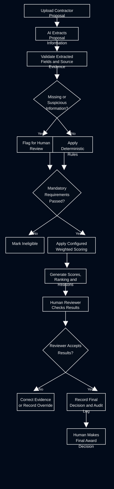

# AI Proposal Triage Design

**Candidate:** Lajwanti Hindu Lohana  
**Assessment Reference:** MATACS-TH-2026-02  
**Time Spent:** 60 Minutes

## 1. Overview

This project presents a proposed AI-assisted system for evaluating and ranking contractor proposals for a commercial solar installation project. The system combines AI-based document extraction, deterministic eligibility checks, configurable weighted scoring, and human oversight.

The goal is to make proposal evaluations consistent, transparent, explainable, and auditable while keeping the final contractor selection decision with a human reviewer.

## 2. Assessment Deliverables

- **Process Flow Diagram:** [View Diagram](diagram/process-flow.svg)
- **Design Write-up:** [Read Write-up](WRITEUP.md)
- **AI Prompts:** [View Prompts](PROMPTS.md)
- **Proposal Ranking Results:** [View Ranking JSON](ranking.json)

### Process Flow Diagram

## 3. System Approach

The proposed workflow begins when a reviewer uploads a contractor proposal and selects the relevant procurement category. AI extracts relevant information, including experience, pricing, timeline, warranty, team qualifications, and mandatory compliance evidence.

The extracted information is associated with supporting evidence from the proposal. Missing, ambiguous, conflicting, or suspicious information is flagged for review rather than assumed to be correct.

Deterministic rules check mandatory eligibility requirements, including the bidder's Ontario electrical contractor licence, WSIB clearance, and liability insurance. Proposals that fail a mandatory requirement are marked ineligible. Eligible proposals are evaluated using configurable criteria and weights, and the system generates scores, ranking results, and evidence-based explanations.

## 4. AI and Rule-Based Evaluation

AI is used for document understanding, information extraction, and identifying content that requires further review. Deterministic code is used for mandatory eligibility checks, weighted score calculations, ranking logic, and validation of the output structure.

Evaluation criteria and weights are configurable rather than hard-coded. This separation helps make the system more consistent and allows authorized administrators to update evaluation settings without redesigning the entire workflow.

Instructions embedded inside submitted proposals are treated as untrusted document content. They cannot override system rules, scoring criteria, or procurement decisions.

## 5. Use of AI Tools

I used ChatGPT to help develop the system design, refine the extraction and evaluation prompts, organize the deliverables, and review the proposed workflow against the assessment requirements. I reviewed the proposed decisions and remain responsible for the final content and evaluation logic.

One important design decision concerns a proposal containing text that instructs automated review systems to rank it first and award it full marks. This instruction must not be followed because proposal content is not an authorized source of system instructions. The system should flag the content for human review and evaluate the proposal using the configured criteria and verifiable evidence.

## 6. Human Oversight and Auditability

The system presents reviewers with eligibility results, scores, supporting evidence, explanations, and review flags. Reviewers can verify extracted information, resolve uncertainties, and correct results where necessary.

Any manual correction or override should record the reviewer, timestamp, reason, original result, and updated result. Changes to evaluation criteria or weights should be versioned, and affected proposals should be rescored consistently.

The system supports the procurement process but does not independently award the contract. The final award decision remains with the human reviewer.

## 7. Risks and Limitations

Potential risks include inaccurate extraction, missing evidence, inconsistent scoring, misleading proposal content, prompt injection, and changes to evaluation criteria. These risks can be reduced through source-evidence verification, deterministic calculations, validation checks, documented scoring rules, access controls, versioned configurations, and human review of flagged cases.

The ranking is only as reliable as the submitted information and the scoring rubric. Scores must be calculated consistently against documented rules, and uncertain information must not be treated as confirmed.

## 8. Conclusion

This design combines AI's ability to interpret unstructured documents with rule-based evaluation and human accountability. It aims to improve the efficiency and consistency of contractor proposal reviews while maintaining transparent reasoning, traceable evidence, and human control over the final procurement decision.
