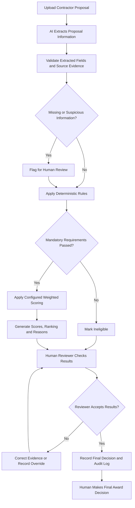

# AI Proposal Triage — Process Flow

## Process Description

1. **Upload:** The contractor proposal enters the system.
2. **AI extraction:** AI extracts relevant experience, licence, insurance, price, timeline, warranty, and team information.
3. **Validation:** Extracted values are checked against source evidence. Missing information and suspicious instructions are flagged.
4. **Rule-based evaluation:** Deterministic code checks mandatory eligibility requirements and applies administrator-configured weighted scoring.
5. **Results:** The system produces scores, rankings, reasons, and flags.
6. **Human review:** A reviewer checks the evidence, resolves uncertainty, and records any corrections or overrides.
7. **Final decision:** The human makes the award decision, and the system retains an audit trail.
